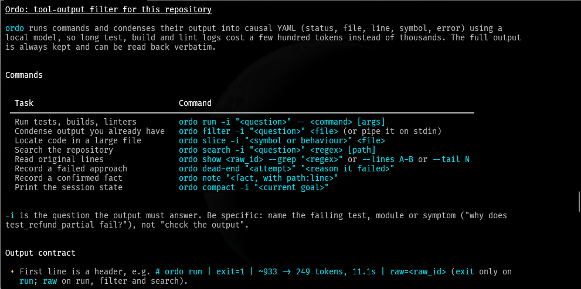

# ordo

<p align="center">
  
</p>

Command-line harness for **[Ordo 3B](https://huggingface.co/devlucascfarias/ordo-3b)**, a small local
model that filters noisy tool output (test runs, builds, linters, large files) into compact causal
YAML for coding agents, so the agent reads the failure cause instead of 10,000 lines of logs.

```
$ ordo run -i "Check why the multi-currency settlement test fails" pytest -v
# ordo run | exit=1 | ~933 -> 249 tokens, 11.1s
status: FAIL
summary: 'KeyError: ''BRL'' in src/ledger/fx.py:5 (fx_rate) when evaluating settle(batch) in src/ledger/settlement.py:7.'
causal_trace:
- file: src/ledger/fx.py
  lines: '5'
  symbol: fx_rate
  issue: 'KeyError: ''BRL'''
...
# ordo: unverified: snippet not verbatim: src/ledger/fx.py:5 (...)
```

## Install

```bash
pip install git+https://github.com/devlucascfarias/ordo.git
ordo setup
```

`pip` installs the CLI only. `ordo setup` checks the model server, downloads the Ordo model through Ollama
if it is missing (about 6.2 GB, after asking; `--yes` skips the question) and runs one test call:

```text
[ok] server: Ollama at http://127.0.0.1:11434 (3 model(s) installed)
[ok] model: ordo:3b
[ok] test call: 8.9s, valid YAML, status FAIL, cites src/fx.py
```

Requires Python 3.10+ and a running [Ollama](https://ollama.com), or any OpenAI-compatible server
(see [Other model servers](#other-model-servers)). The CLI looks for the model as `ordo:3b` and falls
back to any installed `hf.co/devlucascfarias/ordo-3b` tag automatically. Manual install:
`ollama pull hf.co/devlucascfarias/ordo-3b`.

## Commands

| Command | What it does | Mode |
|---|---|---|
| `ordo run -i INTENT [--] CMD...` | runs the command, filters its output, **exits with the command's exit code** | `TOOL_OUTPUT` |
| `ordo filter -i INTENT [FILE]` | filters text from a file or stdin (`cmd \| ordo filter -i ...`) | any (`--mode`) |
| `ordo slice -i INTENT FILE` | finds the symbols/lines relevant to the intent, with real 1-based line numbers | `CODE_SLICE` |
| `ordo search -i INTENT PATTERN [PATHS]` | `rg` (or a built-in fallback) filtered by intent | `TOOL_OUTPUT` |
| `ordo dead-end ATTEMPT REASON` | records an approach that failed, so the agent does not retry it | |
| `ordo note TEXT` | records a confirmed fact | |
| `ordo forget [ID\|TEXT]` | retracts a wrong or obsolete note or dead end (no argument: lists them with ids) | |
| `ordo compact -i GOAL` | writes the session's state ledger (goal, facts, dead ends, modified files) | `MEMORY_COMPACT` |
| `ordo stats [--json]` | token savings telemetry for the session | |
| `ordo show [ID] [--grep RX] [--lines A-B]` | exact lines of a saved run/filter/search output (`raw=<id>` in the header) | |
| `ordo setup [--yes] [--no-test]` | checks the model server, downloads the model if missing, runs a test call | |
| `ordo guide` | instructions for coding agents, to paste into `AGENTS.md` | |
| `ordo mcp [--no-run]` | serve the tools over MCP for any MCP-capable agent | |

Use `--` before the command when it has its own flags that could clash (`ordo run -i "..." -- pytest -v -k foo`).

### Behaviour that agents can rely on

- **Output is always YAML** (or raw text with a `# ordo:` header when the model is unavailable). Warnings
  are YAML comments starting with `# ordo:`.
- **Grounding check.** Every file, line, symbol and snippet the model cites is checked against the input
  (and against the file on disk for `slice`). Anything that is not literally there is flagged with
  `# ordo: unverified: ...`. Treat flagged snippets as untrusted.
- **Never blocks the agent.** If Ollama is down or the YAML is unrecoverable, the raw output is printed
  (windowed around the errors). Use `--no-fallback` to get exit code 3 instead.
- **Short output is passed through** without calling the model (≤40 lines); use `--force` to always filter.
- **Nothing is lost.** Every `run`/`filter`/`search` saves the full output and prints `raw=<id>` in the header;
  `ordo show <id> --grep "KeyError"` returns the exact original lines when the summary is not enough.
- **`--json`** on `run`/`filter`/`slice`/`search`/`stats` prints an envelope with the parsed result, exit code,
  warnings, tokens and `raw_id`.
- **Large input is windowed** to `--budget` tokens (default 6000) around error lines; the cut is marked in the text.
- **`compact` is deterministic by default**: it is built only from what the session recorded: `dead-end`,
  `note` (minus what `ordo forget` retracted), the exit code of each test, build or lint command from the
  last `ORDO_LEDGER_HOURS` (never the model's summary), and the
  modified files from `git status`. A file is `PASS` or `FAIL` only if the last test run started after its
  last change; otherwise it is `UNTESTED`. `--neural` asks the model instead, falling back
  to the deterministic ledger if the output fails the schema (the published Ordo 3B is not reliable
  in this mode yet).
- Session memory lives in `~/.ordo/sessions/`, one file per repository (never inside your repo).
  Use `--session NAME` (or `ORDO_SESSION`) for parallel agents in the same repo.

### Configuration

| Variable | Default |
|---|---|
| `ORDO_MODEL` | `ordo:3b` |
| `OLLAMA_HOST` | `http://127.0.0.1:11434` (server-style values such as `0.0.0.0:11434` are accepted) |
| `ORDO_MAX_INPUT_TOKENS` | `6000` |
| `ORDO_SESSION` | one session per repository |
| `ORDO_KEEP_ALIVE` | `30m` (how long Ollama keeps the model loaded) |
| `ORDO_HOME` | `~/.ordo` |
| `ORDO_LEDGER_HOURS` | `12` (command results older than this are left out of `compact`) |
| `ORDO_BASE_URL` | unset (Ollama). Set it to use an OpenAI-compatible server instead |
| `ORDO_API_KEY` | unset (sent as a Bearer token when the server needs one) |

Exit codes: `run` returns the command's code (127 if not found, 124 on `--cmd-timeout`); `2` for usage
errors; `3` with `--no-fallback` when the model fails; `search` returns `1` when nothing matches.

## Other model servers

Ordo runs on any server with an OpenAI-compatible `/v1/chat/completions` endpoint: llama.cpp
(`llama-server`), LM Studio, vLLM, LocalAI. Point `ORDO_BASE_URL` (or `--base-url`) at it:

```bash
llama-server -m ordo-3b.gguf -c 16384 --port 8080      # context of 16k tokens, as Ordo expects
export ORDO_BASE_URL=http://127.0.0.1:8080              # /v1 is added when missing
ordo run -i "why does the build fail?" -- npm run build
```

The model is picked from the server's `/v1/models` list: the configured `ORDO_MODEL` if served, else a
model whose name contains `ordo`, else the only model served. Set the context size on the server; Ollama's
own `/v1` endpoint ignores it, so with Ollama keep the default native backend.

## Use as an MCP server

`ordo mcp` serves the same tools over MCP (stdio), so MCP-capable coding agents call them natively
(`ordo_run`, `ordo_filter`, `ordo_slice`, `ordo_search`, `ordo_show`, `ordo_dead_end`, `ordo_note`,
`ordo_forget`, `ordo_compact`, `ordo_stats`) and get structured results. Install the extra: `pip install "ordo[mcp] @ git+https://github.com/devlucascfarias/ordo.git"`.

Register it in your agent (command `ordo`, args `["mcp"]`; add `--no-run` for read-only tools):

```bash
claude mcp add ordo -- ordo mcp                      # Claude Code
```

```toml
# Codex: ~/.codex/config.toml
[mcp_servers.ordo]
command = "ordo"
args = ["mcp"]
```

```json
// Cursor (.cursor/mcp.json), Gemini CLI (~/.gemini/settings.json) and most other clients
{ "mcpServers": { "ordo": { "command": "ordo", "args": ["mcp"] } } }
```

The server keeps the model loaded between calls (`ORDO_KEEP_ALIVE`, default 30m) and runs one tool call at a time.

### Python API

```python
from ordo.client import call_ollama_ordo
from ordo.schema import parse_output, repair_yaml_output
from ordo.verify import verify

res = call_ollama_ordo("TOOL_OUTPUT", "Why does the build fail?", log_text)
parsed = parse_output(res.text, "TOOL_OUTPUT")      # YAML (+ repair) and schema validation
report = verify(parsed.obj, log_text, "TOOL_OUTPUT") # grounding check
```

## Known limitations of the published model (Ordo 3B v2.0)

- File paths, line numbers and status are usually right; **`exact_snippets` are sometimes invented**,
  which is why the grounding check exists.
- `MEMORY_COMPACT` does not follow its schema reliably and can invent facts, hence the deterministic `compact`.
- The published GGUF is FP16 (6.2 GB): the first call can take ~45 s while the model loads.

A new version of the model is in training; the CLI contract stays the same.

## Development

```bash
pip install -e ".[dev]"
python -m pytest -q
```

## License

MIT, see [LICENSE](LICENSE).
